# 问题定义：学习从图像与增益生成查找表的映射 Φ

## 1. 问题背景与目标

给定一张线性 BT.2020 RGB 图像 $x$，以及逐像素、逐通道增益 $\mathrm{gain}$，希望先由映射 $\Phi$ 根据二者生成一张查找表 $\mathrm{grid}$。这张表同时带有亮度档和 Lab 色度档，空间分辨率都是 $24\times 32$。运行时按第二维把它拆成亮度网格和色度网格，再做 slicing / sample，得到每个像素的 12 维仿射并作用于 $x$。目标是让结果近似于已知参考映射 $F(x \odot \mathrm{gain})$。

**核心任务是求出一个可部署的映射 $\Phi$，而不是在每次运行时直接调用 $F$ 求表。** $F$ 仅允许在 $\Phi$ 的训练/求解阶段用于构造监督目标；部署时不提供、不调用 $F$。运行时只执行 $\Phi$、既有的两次查表/切片以及仿射合成。

## 2. 整体结构

```mermaid
flowchart TD
    subgraph Train["离线训练 / 求解阶段"]
        X["训练样本 x、gain"] --> T["参考目标 y = F(x ⊙ gain)"]
        X --> P["映射 Φθ(x, gain)"]
        T --> L["最终输出误差与正则项"]
        P --> G["grid (12, 32, 24, 32)"]
        G --> GL["拆出 grid_L"]
        G --> GAB["拆出 grid_ab"]
        GL --> SL["现有 slicing"]
        GAB --> SAB["现有 sample"]
        X --> SL
        X --> SAB
        SL --> SUM["合成预测 ŷ"]
        SAB --> SUM
        SUM --> L
        L -. "反向传播 / 参数更新" .-> P
    end
    subgraph Deploy["部署 / 运行阶段"]
        XD["输入 x、gain"] --> PHI["已训练 Φθ*"]
        PHI --> GD["grid (12, 32, 24, 32)"]
        GD --> GLD["拆出 grid_L"]
        GD --> GABD["拆出 grid_ab"]
        GLD --> SLD["现有 slicing"]
        GABD --> SABD["现有 sample"]
        XD --> SLD
        XD --> SABD
        SLD --> OUT["两套 12 维仿射相加"]
        SABD --> OUT
        OUT --> YD["输出 ŷ"]
    end
```

离线阶段可以调用 $F$，并用真实切片路径计算训练损失。部署阶段仅保留 $\Phi$ 的参数和前向计算，不保留 $F$、优化器状态或训练代码。

## 3. 输入与参考目标

### 3.1 输入

图像和增益均为线性 BT.2020 RGB，D65，形状为 $(B, 3, H, W)$；也可处理不带 batch 的 $(3, H, W)$ 输入。

- $x$：原始线性 RGB 图像；
- $\mathrm{gain}$：逐像素、逐通道增益，与 $x$ 广播兼容；
- 乘法为逐元素乘法，记作 $x \odot \mathrm{gain}$。

增益的三个通道相互独立，因此 $x \odot \mathrm{gain}$ 的色品可能改变，结果也可能超出 $[0,1]$。代码值 1 表示 100 nit 峰值白；输入为线性值，不应用光电转换曲线。

### 3.2 参考映射 $F$

参考映射 $F$ 定义在增益后的线性 BT.2020 RGB 上。当前参考实现是 ACES 2.0 输出变换中的可逆色域压缩，使用简化 Hellwig 2022 外观模型的 JMh 坐标。后续即使更换 $F$，其位置仍保持在「先乘 gain、再进行参考变换」这一环节。

对每个训练样本定义监督目标：

$$
y = F(x \odot \mathrm{gain}).
$$

$F$ 可以在训练时用于生成监督目标、计算误差或分析结果；但 $\Phi$ 的部署实现不得依赖 $F$。

## 4. 输出表及既有运行时算子

### 4.1 一张打包表 $\mathrm{grid}$

$\Phi$ 对每个样本输出一张表。不带 batch 时形状为 $(12, 32, 24, 32)$，带 batch 时为 $(B, 12, 32, 24, 32)$。四个轴依次是：

1. $12$：每个节点的仿射系数。前 9 个是 RGB $3\times 3$，按行展开；最后 3 个是 bias。顺序为 $[a_{00}, a_{01}, a_{02}, a_{10}, a_{11}, a_{12}, a_{20}, a_{21}, a_{22}, b_0, b_1, b_2]$。恒等仿射为 $[1, 0, 0,\ 0, 1, 0,\ 0, 0, 1,\ 0, 0, 0]$。
2. $32$：引导档。这一维整段拆成亮度档和色度档，两者占用的档数之和为 32。
3. $24$：空间高度。
4. $32$：空间宽度。

空间分辨率对亮度和色度都是 $24\times 32$。网格的高和宽必须严格小于图像的高和宽，即 $24 < H$ 且 $32 < W$。

第二维只使用下面三种拆法：

| 方案 | 亮度档数 | 色度档 $(a, b)$ | 色度占用 | 合计 |
| --- | ---: | --- | ---: | ---: |
| 1 | 8 | $4\times 6$ | 24 | 32 |
| 2 | 16 | $4\times 4$ | 16 | 32 |
| 3 | 32 | 无 | 0 | 32 |

$4\times 6$ 表示 $a$ 方向 4 档、$b$ 方向 6 档。$4\times 4$ 表示 $a$、$b$ 各 4 档。方案 3 没有色度档。

前 $D$ 档是亮度网格：

$$
\mathrm{grid}_L = \mathrm{grid}[:, :D], \qquad \mathrm{grid}_L \in \mathbb{R}^{12 \times D \times 24 \times 32}.
$$

其余档按 $(a, b)$ 排成色度网格，$a$ 在前、$b$ 在后：

$$
\mathrm{grid}_{ab} = \mathrm{grid}[:, D:].\mathrm{reshape}(12, N_a, N_b, 24, 32).
$$

方案 1 中 $(N_a, N_b) = (4, 6)$，方案 2 中 $(N_a, N_b) = (4, 4)$。方案 3 不构造 $\mathrm{grid}_{ab}$。

亮度档的深度引导是原始 $x$ 的 Lab $L^\*$，归一化为 $L^\*/100$ 并夹到 $[0, 1]$。Lab 在把 $x$ 的 RGB 夹到 $[0, 1]$ 之后计算。

### 4.2 运行时切片

亮度网格先沿 $24\times 32$ 做空间双线性上采样，再沿 $L^\*$ 线性插值，得到每个像素的 12 维仿射 $(A^L_i, b^L_i)$。

色度网格使用同一套 $24\times 32$ 空间双线性上采样，并按原始 $x$ 的 Lab $(a, b)$ 在色度档上双线性采样。$a/128$、$b/128$ 夹到 $[-1, 1]$，采样坐标次序是 $(b, a)$，`align_corners=True`，越界取边界值。得到每个像素的另一个 12 维仿射 $(A^{ab}_i, b^{ab}_i)$。方案 3 的这一项为零。

两个仿射相加后作用在未裁剪的 $x$ 上：

$$
\hat{y}_i = (A^L_i + A^{ab}_i)\, x_i + (b^L_i + b^{ab}_i).
$$

部署时不调用 $F$。输出是否裁剪到 $[0, 1]$ 由既有应用逻辑决定；与参考目标比较时，先比较未裁剪结果。

## 5. 待求解的对象：映射 $\Phi$

目标是得到一个可部署的映射：

$$
\Phi_\theta:(x, \mathrm{gain}) \longmapsto \mathrm{grid}, \qquad \mathrm{grid} \in \mathbb{R}^{12 \times 32 \times 24 \times 32}.
$$

$\Phi$ 的具体形式不预先限定，可以是神经网络、闭式近似、迭代-free 算法或其他映射。关键要求是：给定当前 $x$ 和 $\mathrm{gain}$，它能直接输出上述形状的表，并按第 4 节的三种方案之一解释第二维。运行时不依赖 $F$，也不执行额外的逐像素色域压缩。

对于神经网络参数化的 $\Phi$，可用监督学习来求解其参数 $\theta$。对训练样本对 $(x, \mathrm{gain})$，目标是：

$$
\begin{aligned}
\mathrm{grid} &= \Phi_\theta(x, \mathrm{gain}), \\
\hat{y} &= S(\mathrm{grid}, x), \\
y &= F(x \odot \mathrm{gain}).
\end{aligned}
$$

通过最小化最终切片输出和参考输出之间的差异，学习 $\Phi$ 的参数：

$$
\theta^\* = \arg\min_\theta \mathbb{E}_{(x, \mathrm{gain}) \sim \mathcal{D}} \left[ \mathcal{L}(\hat{y}, y) + \lambda \mathcal{R}(\mathrm{grid}) \right].
$$

其中：

- $\mathcal{D}$ 是训练时覆盖预期输入范围的图像与增益分布；
- $\mathcal{L}$ 是输出误差，例如线性 RGB 的加权平方误差；
- $\mathcal{R}$ 是可选正则项，用于控制亮度档的空间/深度平滑、色度档的空间与 $(a, b)$ 平滑，以及在缺乏数据支持时对恒等仿射和零色度档的先验；
- $\lambda$ 控制正则项权重。

这里的神经网络只是可选实现，并非问题定义强制要求。也可以设计非神经网络的 $\Phi$，只要满足同样的输入输出关系、训练/求解约束和部署约束。

## 6. 训练与部署的边界

### 训练 / 求解阶段允许

1. 调用 $F(x \odot \mathrm{gain})$ 生成监督目标；
2. 使用现有 slicing、sample 路径计算预测结果；
3. 使用反向传播、数值优化或其他算法求解 $\Phi$；
4. 通过多种图像和增益样本拟合映射，并验证泛化误差。

### 部署阶段要求

1. 输入当前图像 $x$ 和 $\mathrm{gain}$；
2. 只通过 $\Phi$ 生成形状为 $(12, 32, 24, 32)$ 的 $\mathrm{grid}$，再按选定方案拆出亮度档和色度档；
3. 使用原有 slicing 与 sample 得到结果；
4. 不调用 $F$，不依赖训练集、标签或在线优化器；
5. 保持既定表形状、第二维拆分、坐标约定和插值规则；
6. 空间网格固定为 $24\times 32$，并且严格小于图像的高和宽。

## 7. 评价标准

评价 $\Phi$ 时应通过完整部署路径进行，而不只检查预测表本身。对每个验证样本，计算：

$$
\hat{y} = S(\Phi_\theta(x, \mathrm{gain}), x)
$$

并与 $F(x \odot \mathrm{gain})$ 比较。建议至少报告：

- 线性 RGB 的平均平方误差与 RMSE；
- 最大绝对误差和高分位误差；
- 高饱和度、超出 $[0, 1]$ 的增益结果及高亮区域的误差；
- 不同图像、不同增益分布上的泛化表现；
- $\Phi$ 的推理耗时、峰值内存和输出表尺寸。

参考目标本身不应在比较前被裁剪；若部署端最终会裁剪，则应另外报告裁剪后误差，避免混淆模型误差和输出裁剪误差。

## 8. 核心问题总结

需要解决的是：**设计并求解一个映射 $\Phi$，使其仅根据输入图像 $x$ 与逐通道增益 $\mathrm{gain}$，生成形状为 $(12, 32, 24, 32)$ 的表；第二维按 $8+4\times 6$、$16+4\times 4$ 或 $32+0$ 拆成亮度档和色度档，空间分辨率都是 $24\times 32$。通过既有 slicing、sample 和仿射合成后，最终输出尽可能接近参考目标 $F(x \odot \mathrm{gain})$。**

$F$ 是训练/求解阶段可用的参考监督，不是运行时依赖。最终交付物是可部署的 $\Phi$ 及其参数，而不是针对每个输入临时调用 $F$ 的优化过程。
